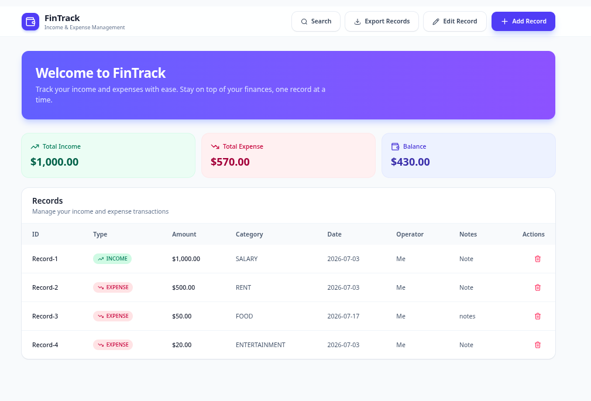
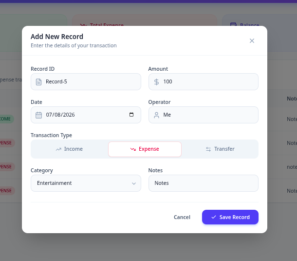
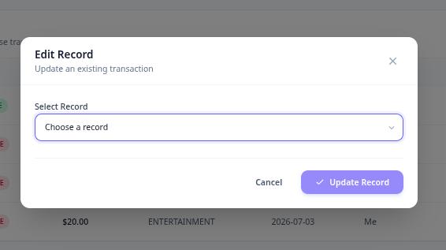
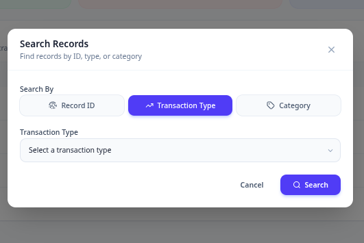
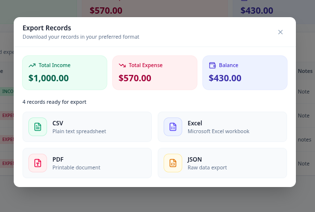
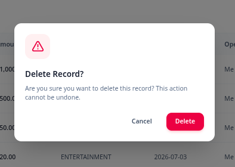

# FinTrack

FinTrack is a full-stack Income & Expense Management dashboard. It provides a clean, modern interface for creating, editing, searching, downloading, and deleting financial records, backed by a Java REST API and PostgreSQL.

---

## Table of Contents

- [Overview](#overview)
- [Tech Stack](#tech-stack)
- [Architecture](#architecture)
- [Features](#features)
- [Screenshots](#screenshots)
- [Getting Started](#getting-started)
- [API Endpoints](#api-endpoints)
- [Project Structure](#project-structure)
- [License](#license)

---

## Overview

FinTrack allows users to track personal or business transactions. Each record includes:

- Unique record ID
- Transaction type (Income / Expense / Transfer)
- Amount
- Category (Salary, Rent, Transport, Shopping, Food, Entertainment, Other)
- Date
- Operator
- Notes

The frontend is a Vue 3 SPA served directly from the Java backend WAR, making deployment simple and self-contained.

---

## Tech Stack

### Backend

| Technology | Purpose |
|------------|---------|
| Java 17 | Programming language |
| JAX-RS (Jersey 2.40) | REST API framework |
| Hibernate 5.6 | ORM for database operations |
| PostgreSQL | Relational database |
| Maven | Build and dependency management |
| Apache Tomcat | Servlet container |

### Frontend

| Technology | Purpose |
|------------|---------|
| Vue 3 | UI framework |
| TypeScript | Type-safe JavaScript |
| Vite | Build tool and dev server |
| Tailwind CSS 4 | Utility-first styling |
| Lucide Vue | Icon library |
| Vue Router | Client-side routing |

### Utilities

| Technology | Purpose |
|------------|---------|
| SheetJS (xlsx) | Excel export |
| jsPDF + jspdf-autotable | PDF export |

---

## Architecture

```
┌─────────────────────────────────────────────────────────────┐
│                         Client Browser                        │
└───────────────────────────┬─────────────────────────────────┘
                            │ HTTP
┌───────────────────────────▼─────────────────────────────────┐
│                  Apache Tomcat Server                         │
│  ┌─────────────────────────────────────────────────────────┐│
│  │              FinTrack.war                                ││
│  │  ┌──────────────┐  ┌──────────────────────────────┐    ││
│  │  │ Static Files │  │   Jersey REST API (JAX-RS)   │    ││
│  │  │  index.html  │  │   /api/records               │    ││
│  │  │  assets/     │  │   /api/records/{id}          │    ││
│  │  │  ...         │  │   /api/records/type/{type}   │    ││
│  │  └──────────────┘  │   /api/records/category/{cat}│    ││
│  │                    └──────────────────────────────┘    ││
│  └─────────────────────────────────────────────────────────┘│
└───────────────────────────┬─────────────────────────────────┘
                            │ JDBC
┌───────────────────────────▼─────────────────────────────────┐
│                    PostgreSQL Database                        │
└─────────────────────────────────────────────────────────────┘
```

### Key Design Decisions

- **Single WAR deployment**: The Vue frontend is built and embedded into `src/main/webapp`, then packaged into the same WAR as the backend.
- **Hash-based routing**: `createWebHashHistory()` avoids base-path issues when deploying under different context paths.
- **Relative API base**: The frontend falls back to relative `api` paths, so it works whether served at `/` or `/FinTrack/`.
- **Teleport for modals**: All modal overlays are teleported to `<body>` to avoid CSS `backdrop-filter` containing-block bugs from the sticky header.

---

## Features

### Dashboard

- Welcome banner
- Summary cards: Total Income, Total Expense, Balance
- Full records table with delete action

### Add Record

- Modal form with ID, amount, date, operator, type, category, and notes
- Segmented control for transaction type
- Validation and backend error display (e.g., duplicate ID)

### Edit Record

- Select an existing record from a dropdown
- Update any field
- Refreshes the dashboard after saving

### Search Records

- Search by Record ID
- Search by Transaction Type
- Search by Category
- Results displayed inside the search modal

### Download / Export Records

- Export as CSV
- Export as Excel (.xlsx)
- Export as PDF
- Export as JSON
- Summary cards shown before download

### Delete Record

- Custom confirmation modal
- Refreshes the dashboard after deletion

---

## Screenshots

### 1. Dashboard



### 2. Add Record Modal



### 3. Edit Record Modal



### 4. Search Records Modal



### 5. Download / Export Records Modal



### 6. Delete Confirmation Modal



---

## Getting Started

### Prerequisites

- Java 17
- Maven
- Node.js 18+ and npm
- Docker (for PostgreSQL)
- Apache Tomcat (or use the one bundled with your IDE)

### 1. Start PostgreSQL

```bash
docker compose up -d
```

### 2. Build the Frontend

```bash
cd frontend
npm install
npm run build
cd ..
```

### 3. Copy Frontend into the WAR

```bash
rm -rf src/main/webapp/*.html src/main/webapp/assets src/main/webapp/favicon.svg src/main/webapp/icons.svg
cp -r frontend/dist/* src/main/webapp/
```

### 4. Build the Backend

```bash
./mvnw clean package
```

### 5. Deploy to Tomcat

Copy `target/FinTrack.war` to your Tomcat `webapps/` directory and start Tomcat.

### 6. Open the App

```text
http://localhost:8080/
```

The API is available at:

```text
http://localhost:8080/api/records
```

---

## API Endpoints

| Method | Endpoint | Description |
|--------|----------|-------------|
| POST | `/api/records` | Create a new record |
| GET | `/api/records` | Get all records |
| GET | `/api/records/{id}` | Get record by ID |
| GET | `/api/records/type/{type}` | Get records by type |
| GET | `/api/records/category/{category}` | Get records by category |
| DELETE | `/api/records/{id}` | Delete a record |

---

## Project Structure

```
FinTrack/
├── docker-compose.yml          # PostgreSQL service
├── pom.xml                     # Maven configuration
├── src/
│   └── main/
│       ├── java/com/web/fintrack/   # Backend source
│       │   ├── api/              # JAX-RS resources
│       │   ├── dao/              # Repository implementations
│       │   ├── domain/           # Models and enums
│       │   ├── repository/       # Repository interfaces
│       │   └── service/          # Business logic
│       ├── resources/            # Hibernate config
│       └── webapp/               # Frontend build output
│           ├── index.html
│           ├── assets/
│           └── WEB-INF/web.xml
├── frontend/
│   ├── src/
│   │   ├── components/       # AddRecordForm, EditRecordForm, DownloadRecord, SearchRecord
│   │   ├── pages/            # Home.vue
│   │   ├── router/           # Vue Router config
│   │   ├── services/         # recordApi.ts
│   │   ├── types/            # Records.ts
│   │   ├── App.vue
│   │   └── main.ts
│   ├── index.html
│   ├── package.json
│   ├── vite.config.ts
│   └── .env
├── docs/
│   └── screenshots/          # Feature screenshots
└── README.md
```

---

## License

This project is for educational and demonstration purposes.
