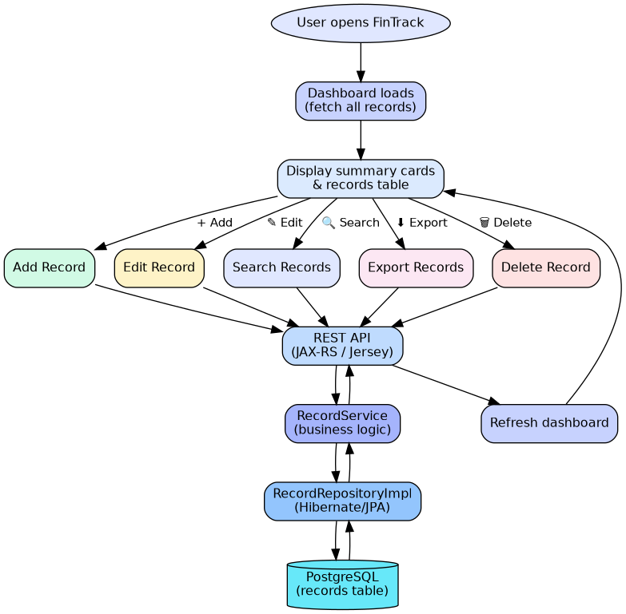
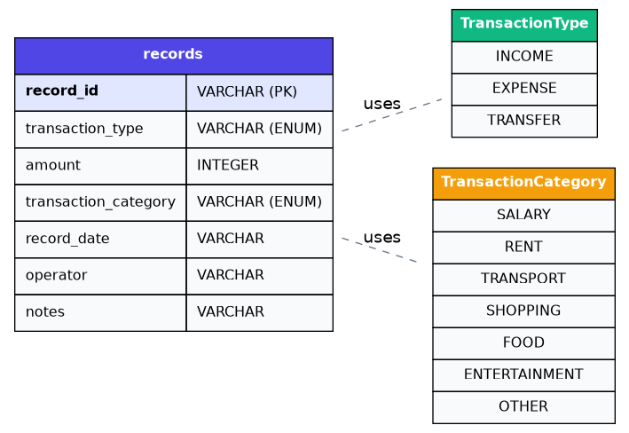

# FinTrack — Full Project Report

> **Income & Expense Management Dashboard**  
> A full-stack Java + Vue 3 application for tracking personal or business financial transactions.

---

## 1. Project Introduction

**FinTrack** is a web-based Income and Expense Management system that provides a clean, modern dashboard for creating, editing, searching, exporting, and deleting financial records. It is designed as a self-contained, single-WAR application where a Vue 3 frontend is served directly by a Java backend running on Apache Tomcat.

The application addresses the common need for simple, centralized transaction tracking. Users can log every income, expense, or transfer, categorize each transaction, assign an operator and date, and instantly see summary metrics such as total income, total expense, and current balance.

### Core Objectives

- Provide an intuitive interface for managing financial records.
- Offer real-time summary calculations on the dashboard.
- Support flexible search by record ID, transaction type, and category.
- Enable data portability through CSV, Excel, PDF, and JSON exports.
- Demonstrate a classic layered Java backend with JAX-RS, Hibernate/JPA, and PostgreSQL.

---

## 2. Project Specification

### 2.1 Functional Requirements

| Feature | Description |
|---------|-------------|
| **Dashboard** | Displays a welcome banner, summary cards (Total Income, Total Expense, Balance), and a paginated-style records table. |
| **Add Record** | Modal form to create a transaction with ID, amount, date, operator, type, category, and notes. |
| **Edit Record** | Dropdown selection of an existing record, with a form to update any field. |
| **Search Records** | Search by Record ID, Transaction Type, or Category, with results shown inside the search modal. |
| **Export Records** | Download all records as CSV, Excel (.xlsx), PDF, or JSON, with summary cards shown before export. |
| **Delete Record** | Confirmation modal before permanently deleting a record. |

### 2.2 Data Model

Each financial record contains the following fields:

| Field | Type | Description |
|-------|------|-------------|
| `record_id` | String (PK) | Unique identifier for the record. |
| `transaction_type` | Enum | Type of transaction: `INCOME`, `EXPENSE`, or `TRANSFER`. |
| `amount` | Integer | Transaction amount (must be greater than zero). |
| `transaction_category` | Enum | Category: `SALARY`, `RENT`, `TRANSPORT`, `SHOPPING`, `FOOD`, `ENTERTAINMENT`, `OTHER`. |
| `record_date` | String | Date of the transaction. |
| `operator` | String | Person or system that recorded the transaction. |
| `notes` | String | Optional additional notes. |

### 2.3 API Specification

| Method | Endpoint | Description |
|--------|----------|-------------|
| `POST` | `/api/records` | Create a new record. |
| `GET` | `/api/records` | Retrieve all records. |
| `GET` | `/api/records/{id}` | Retrieve a single record by ID. |
| `GET` | `/api/records/type/{type}` | Retrieve records by transaction type. |
| `GET` | `/api/records/category/{category}` | Retrieve records by category. |
| `DELETE` | `/api/records/{id}` | Delete a record by ID. |

### 2.4 Validation Rules

- `record_id` is required and must be unique.
- `amount` must be greater than zero.
- `transaction_type` is required.
- Deleting a record requires a valid, existing ID.

---

## 3. Flowchart

The diagram below illustrates the end-to-end flow of a user interacting with FinTrack, from opening the application through the backend layers to the database, and back to the refreshed dashboard.



### Flow Description

1. The **user opens FinTrack** in a browser.
2. The **Dashboard** loads by fetching all records from the backend.
3. The dashboard displays **summary cards** and a **records table**.
4. The user can choose to **Add**, **Edit**, **Search**, **Export**, or **Delete** a record.
5. Each action calls the **REST API (JAX-RS / Jersey)**.
6. The API delegates to **RecordService**, which enforces business logic and validation.
7. **RecordRepositoryImpl** uses **Hibernate/JPA** to persist or query data.
8. Data is stored in a **PostgreSQL** `records` table.
9. After a mutation, the dashboard refreshes and displays the latest data.

---

## 4. Entity Relationship Diagram (ERD)

FinTrack uses a single main entity. The two enumerations are stored as strings in the database and constrain the values of `transaction_type` and `transaction_category`.



### Entity Details

- **`records`** — the central table that stores every transaction.
  - `record_id` is the primary key.
  - `transaction_type` references the `TransactionType` enum values (`INCOME`, `EXPENSE`, `TRANSFER`).
  - `transaction_category` references the `TransactionCategory` enum values (`SALARY`, `RENT`, `TRANSPORT`, `SHOPPING`, `FOOD`, `ENTERTAINMENT`, `OTHER`).

Hibernate is configured with `hbm2ddl.auto = update`, so the schema is created or updated automatically at startup.

---

## 5. Tech Stack

### 5.1 Backend

| Technology | Version | Purpose |
|------------|---------|---------|
| Java | 17 | Core programming language. |
| JAX-RS (Jersey) | 2.40 | REST API framework. |
| Hibernate | 5.6.15.Final | Object-Relational Mapping (ORM). |
| JPA | 2.2 | Standard persistence API. |
| PostgreSQL | 42.7.2 (driver) | Relational database. |
| Maven | — | Build and dependency management. |
| Apache Tomcat | — | Servlet container / deployment target. |

### 5.2 Frontend

| Technology | Version | Purpose |
|------------|---------|---------|
| Vue | 3 | Progressive UI framework. |
| TypeScript | — | Type-safe JavaScript development. |
| Vite | — | Fast build tool and dev server. |
| Tailwind CSS | 4 | Utility-first styling. |
| Lucide Vue | — | Modern icon library. |
| Vue Router | — | Client-side routing. |

### 5.3 Utilities

| Technology | Purpose |
|------------|---------|
| SheetJS (`xlsx`) | Excel export. |
| jsPDF + `jspdf-autotable` | PDF export. |

---

## 6. Implementation

### 6.1 Architecture Overview

FinTrack follows a layered architecture packaged into a single WAR file:

```
┌─────────────────────────────────────────────────────────────┐
│                       Client Browser                          │
└───────────────────────────┬─────────────────────────────────┘
                            │ HTTP
┌───────────────────────────▼─────────────────────────────────┐
│                  Apache Tomcat Server                         │
│  ┌─────────────────────────────────────────────────────────┐│
│  │              FinTrack.war                                ││
│  │  ┌──────────────┐  ┌──────────────────────────────┐    ││
│  │  │ Static Files │  │   Jersey REST API (JAX-RS)   │    ││
│  │  │  index.html  │  │   /api/records               │    ││
│  │  │  assets/     │  │   /api/records/{id}          │    ││
│  │  │  ...         │  │   /api/records/type/{type}   │    ││
│  │  └──────────────┘  │   /api/records/category/{cat}│    ││
│  │                    └──────────────────────────────┘    ││
│  └─────────────────────────────────────────────────────────┘│
└───────────────────────────┬─────────────────────────────────┘
                            │ JDBC
┌───────────────────────────▼─────────────────────────────────┐
│                    PostgreSQL Database                        │
└─────────────────────────────────────────────────────────────┘
```

### 6.2 Backend Layers

#### Application Entry Point

`FinTrackApplication` registers the JAX-RS resources and exception mapper with Jersey:

```java
public class FinTrackApplication extends Application {
    @Override
    public Set<Class<?>> getClasses() {
        Set<Class<?>> classes = new HashSet<>();
        classes.add(RecordResource.class);
        classes.add(IllegalArgumentExceptionMapper.class);
        return classes;
    }
}
```

#### REST Controller

`RecordResource` exposes the `/api/records` endpoints and maps HTTP verbs to service calls:

- `POST /api/records` — create a record and return `201 Created` with a `Location` header.
- `GET /api/records` — list all records.
- `GET /api/records/{id}` — fetch one record or return `404 Not Found`.
- `GET /api/records/type/{type}` — filter by transaction type.
- `GET /api/records/category/{category}` — filter by category.
- `DELETE /api/records/{id}` — delete a record and return `204 No Content`.

#### Service Layer

`RecordService` contains the business logic and validation:

- Rejects null records.
- Requires a non-empty, unique `record_id`.
- Ensures `amount` is greater than zero.
- Requires a `transaction_type`.
- Verifies the record exists before deletion.

#### Data Access Layer

`RecordRepositoryImpl` implements the `RecordRepository` interface using JPA/Hibernate. It provides helper methods for transaction management:

- `execute(...)` — read-only operations.
- `executeInTransaction(...)` — write operations with rollback on failure.

All operations go through the `fintrack-pu` persistence unit, which connects to PostgreSQL.

#### Domain Model

The `Record` entity is mapped to the `records` table:

```java
@Entity
@Table(name = "records")
public class Record {
    @Id
    @Column(name = "record_id")
    private String recordId;

    @Enumerated(EnumType.STRING)
    @Column(name = "transaction_type")
    private TransactionType transactionType;

    @Column(name = "amount")
    private int amount;

    @Enumerated(EnumType.STRING)
    @Column(name = "transaction_category")
    private TransactionCategory transactionCategory;

    @Column(name = "record_date")
    private String date;

    @Column(name = "operator")
    private String operator;

    @Column(name = "notes")
    private String notes;
}
```

### 6.3 Frontend Structure

The frontend is a Vue 3 Single Page Application (SPA) with the following structure:

```
frontend/src/
├── App.vue                 # Root component (renders RouterView)
├── main.ts                 # Application bootstrap
├── style.css               # Global Tailwind imports
├── types/Records.ts        # TypeScript enums and RecordItem interface
├── router/router.ts        # Vue Router configuration
├── services/recordApi.ts   # HTTP client for the REST API
├── pages/Home.vue          # Dashboard page
└── components/
    ├── AddRecordForm.vue   # Add-record modal
    ├── EditRecordForm.vue  # Edit-record modal
    ├── SearchRecord.vue    # Search modal
    └── DownloadRecord.vue  # Export modal
```

#### API Client

`recordApi.ts` uses the browser `fetch` API to communicate with the backend. It reads an optional `VITE_API_BASE_URL` environment variable and falls back to a relative `api` path, which allows the same build to work at `/` or under a context path such as `/FinTrack/`.

#### Dashboard (`Home.vue`)

The dashboard:

- Loads all records on mount via `recordApi.getAll()`.
- Computes `totalIncome`, `totalExpense`, and `balance` as Vue computed properties.
- Renders a responsive records table with Tailwind CSS.
- Provides a delete confirmation modal using `<Teleport>` to mount the overlay on `<body>`.
- Emits events from child components (`@added`, `@updated`) to refresh the list after mutations.

#### Modals

Each major action is implemented as a modal component:

- **AddRecordForm.vue** — segmented control for transaction type, validation, success/error states.
- **EditRecordForm.vue** — selects a record from a dropdown, then deletes the old record and creates the updated one.
- **SearchRecord.vue** — supports search by ID, type, or category with inline results.
- **DownloadRecord.vue** — loads records and offers CSV, Excel, PDF, and JSON downloads.

### 6.4 Deployment Build Flow

1. Start PostgreSQL via `docker compose up -d`.
2. Install frontend dependencies: `npm install`.
3. Build the frontend: `npm run build`.
4. Copy `frontend/dist/*` into `src/main/webapp/`.
5. Package with Maven: `./mvnw clean package`.
6. Deploy `target/FinTrack.war` to Tomcat.

### 6.5 Key Design Decisions

- **Single WAR deployment** — simplifies ops by bundling frontend and backend together.
- **Hash-based routing** (`createWebHashHistory`) — avoids base-path issues in different Tomcat contexts.
- **Relative API base** — frontend works whether served at root or under `/FinTrack/`.
- **Teleport for modals** — prevents `backdrop-filter` containing-block bugs caused by the sticky header.
- **Update edit strategy** — the edit flow deletes the old record and creates a new one because the backend does not expose a dedicated `PUT` endpoint.

---

## 7. GitHub Repository

The full source code, build instructions, and screenshots are available on GitHub:

**https://github.com/Abdev314/FinTrack**

---

*Report generated for the FinTrack project.*
